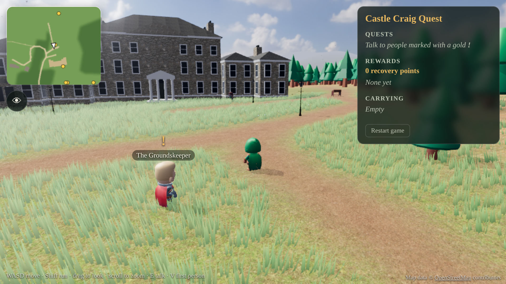
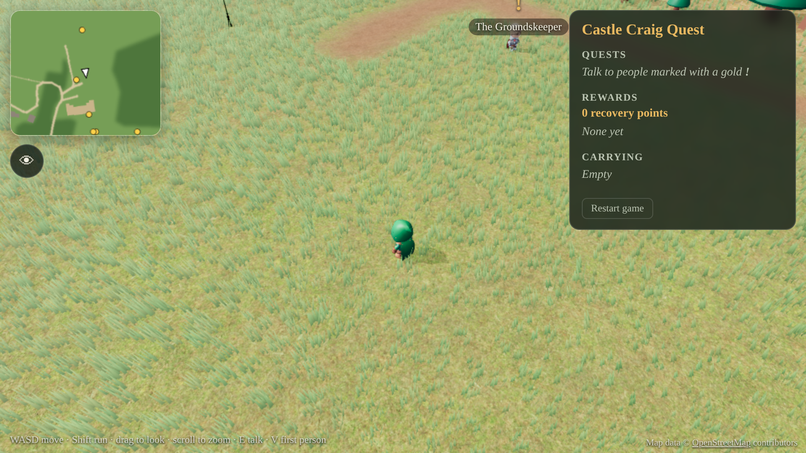
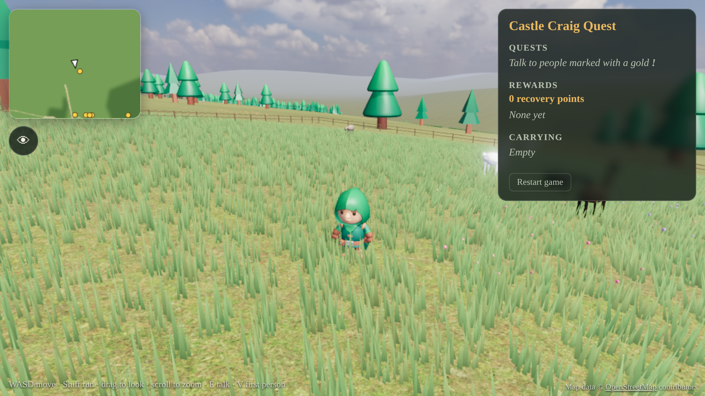
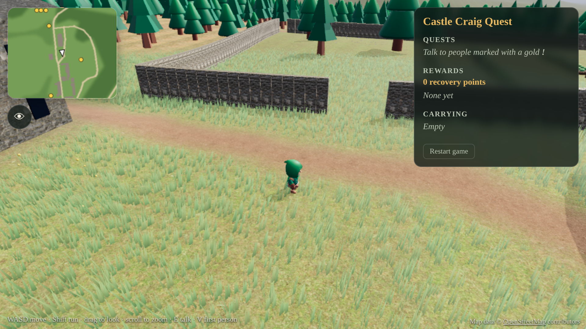
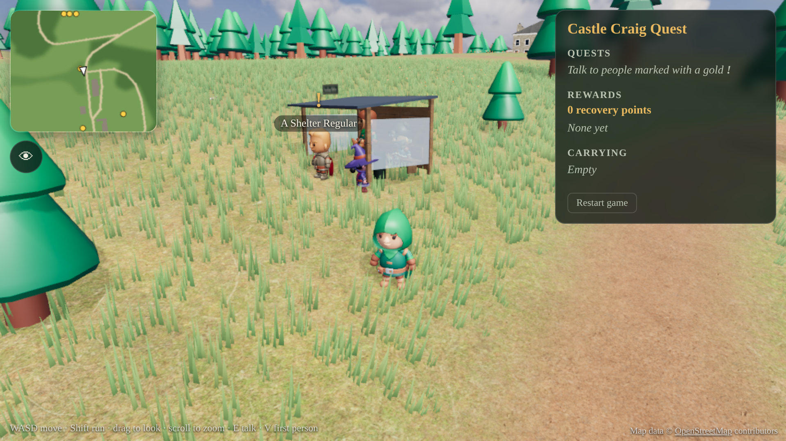
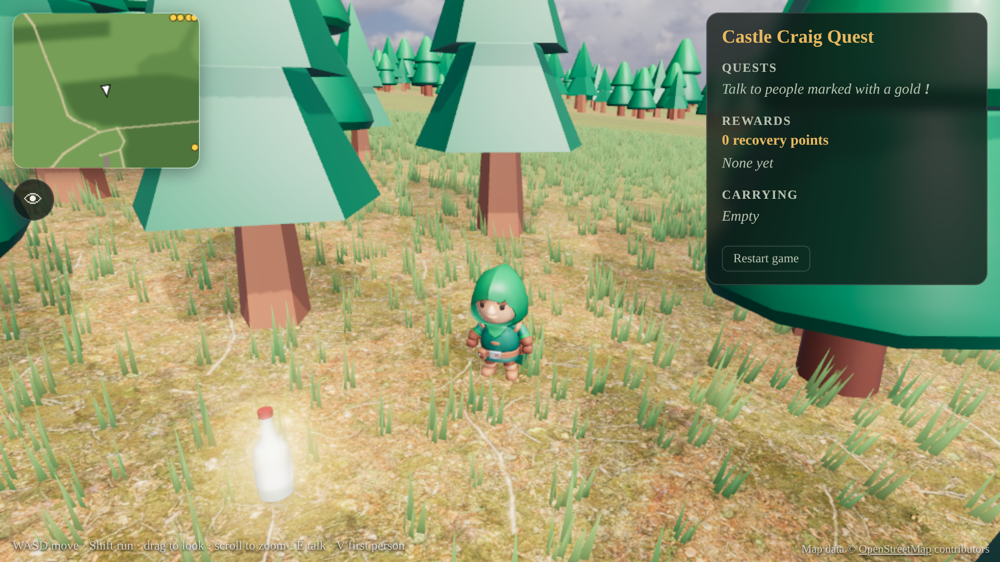
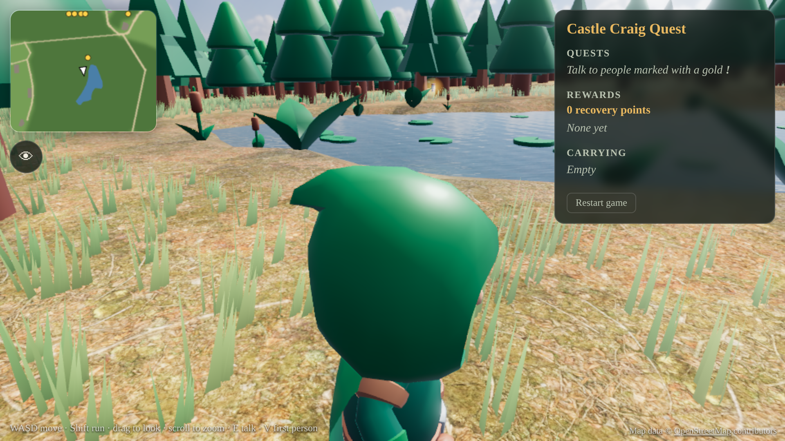
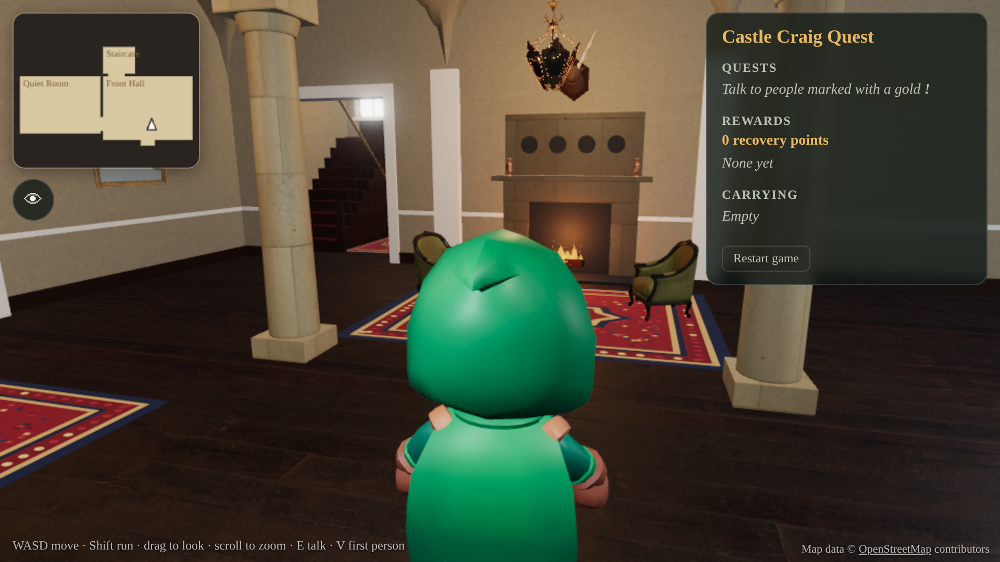
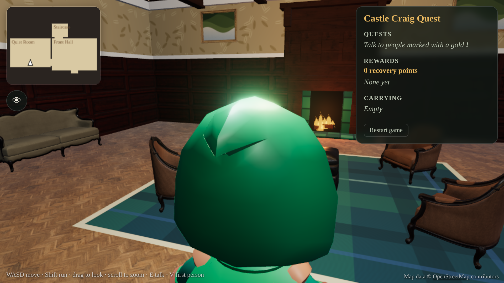
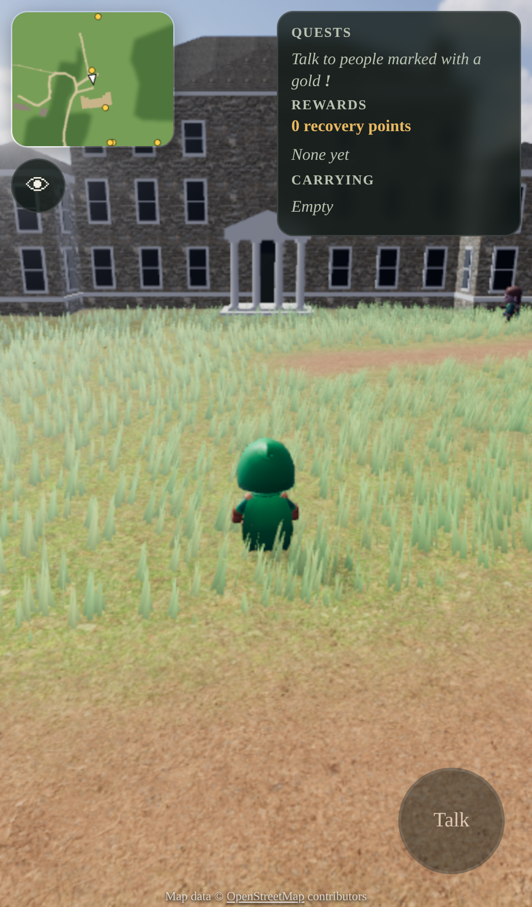

# Castle Craig Quest

A 3D browser game set in the grounds of Castle Craig ([castlecraig.co.uk](https://www.castlecraig.co.uk)).
Roam the estate, talk to the people you meet and complete their quests.

The map is built from real-world data: the buildings, drives, woods, walls, hedges and lake come from
OpenStreetMap, and the ground heights and surrounding hills from open elevation data. Alpacas graze in a
paddock north of the house, rabbits hop about the meadows and birds wheel over the woods.

Built with [Three.js](https://threejs.org) and [Vite](https://vite.dev), using free CC0 assets from
[Poly Haven](https://polyhaven.com) and [KayKit](https://kaylousberg.com) (see [CREDITS.md](CREDITS.md)).



## Play locally

```bash
npm install
```

```bash
npm run dev
```

Then open the address Vite prints (usually http://localhost:5173).

### Controls

| | Desktop | Phone / tablet |
| --- | --- | --- |
| Move | WASD or arrow keys | Drag on the left half of the screen |
| Run | Hold Shift | Push the stick all the way out |
| Look around | Drag with the mouse, scroll to zoom | Drag on the right half of the screen |
| Talk / continue / pat an alpaca | E, Space or Enter | **Talk** button |
| First-person view | V, or scroll all the way in | 👁 button |
| Resist (fighting Michael) | F | **Resist** button |

Progress saves automatically in the browser. Use **Restart game** in the quest panel to start again.

## Quests

| Quest | Given by | What to do |
| --- | --- | --- |
| Find the empty vodka bottle | The Groundskeeper (north drive) | Search the woods south-west of the clinic gardens and bring the bottle back. |
| Find the bag of drugs | The Nurse (by the lake) | Search the lake's edge and hand the bag in. |
| Dining hall dash | The Cook (back of the house) | Run to the dining hall in the Recovery Gardens and back to the front door in 90 seconds. |
| Sneak a vape into the house | The Resident (walled garden) | Collect the vape just north of the walled garden and reach the front door without the Night Porter seeing you. If you're spotted, the vape goes back to its hiding place. |
| Find the pack of cigarettes | A Shelter Regular (smoking shelter) | Find the pack dropped near the Old Watermill and bring it back to the shelter. |
| Find the 3 lost alpacas | The Alpaca Keeper (paddock gate) | Three alpacas have wandered off across the estate. Pat each one so it follows you, then lead them back into the paddock. |
| Clear out Michael's stash | The Counsellor (south lawn) | Once Michael is banished, find the hip flask, scratchcard and betting slip he left in quiet corners of the estate. |
| Letters home | The Receptionist (front porch) | Collect letters from three residents around the grounds and post them in the pillar box by the front door within 6 minutes. |
| Alpaca walk | The Therapy Coordinator (paddock gate) | Lead an alpaca on a rope to the lake and back. If Michael is still about and gets close, she bolts. |
| Night-time round | The Night Porter (forecourt) | Night falls and you get a torch. Find the resident who hasn't come in and lead them back to the porch. |

### Michael

Michael wanders the grounds trying to tempt residents into giving up on their recovery. Walk up to him and
press E to confront him. In the battle he circles you, throwing temptations that drain your willpower; press F
(or tap **Resist**) to fire affirmations back until his hold breaks and he's banished from the estate. If your
willpower runs out, you take a breath back at the house and can try again.

Banishing Michael isn't the end of him. Every couple of minutes he turns up again somewhere ahead of you on the
grounds and walks over to try his luck. Confront him for a rematch (he gets a little quicker each time, and each
win is worth bonus points), or walk away and he'll slink off until next time. He never follows you indoors.

Every quest gives recovery points and a badge, shown in the quest panel. The dining hall dash also earns new
running shoes (15% faster running), and finishing everything earns the Castle Craig Graduate badge.

Walk through the house's front door to go inside. The rooms are modelled on the photos and descriptions on
castlecraig.co.uk's Facilities & Rooms page: the Front Hall, the Drawing Room (sage walls over oak panelling,
brass chandeliers, big Georgian windows onto the front lawn), the Common Room, the Quiet Room, a Group Therapy
Room with a ring of tub chairs, and upstairs a bedroom corridor with two bedrooms. They're arranged to fit the
real building's footprint, but the real floor plans aren't public, so room positions are a best fit.

Hidden items lie in the grass and only glint when you're right next to them, so listen to the hints. Quests against the clock are
different: while the timer runs, each target gets a light beam, a minimap marker and an on-screen arrow with the
distance.

## Building and deploying

```bash
npm run build
```

This writes a static site to `dist/` that can be hosted anywhere (GitHub Pages, Netlify, Cloudflare Pages
or a folder on the existing website). The included GitHub Actions workflow publishes it to GitHub Pages on
every push to `main` once Pages is enabled for the repository (Settings → Pages → Source: GitHub Actions).

Add `?q=low` or `?q=high` to the URL to force the graphics quality. Phones and small screens use low quality
by default (fewer grass blades, smaller shadow maps, no ferns).

## Project layout

| Path | What it is |
| --- | --- |
| `src/main.js` | Renderer, lighting, camera, controls, quest logic, the Night Porter's patrol and the HUD |
| `src/interior.js` | The house interior: Front Hall, Quiet Room and staircase |
| `src/rooms.js` | More rooms: Drawing Room, Common Room, Group Therapy Room and the bedrooms upstairs |
| `src/world.js` | Builds the estate from the map data: terrain, hills, buildings, the house, walls, hedges, trees, grass, the lake and the smoking shelter |
| `src/animals.js` | Alpacas, rabbits, garden birds and rooks |
| `src/villain.js` | Michael, who wanders the grounds, and the battle to banish him |
| `src/sidequests.js` | Michael's stash, Letters home, the Alpaca walk and the Night-time round |
| `src/layout.js` | Ground height, the ground mask and collision, read from the map data |
| `src/quests.js` | Characters, quest text, item positions and the patrol route |
| `src/characters.js` | Animated characters (idle, walk, run, cheer, pick up) |
| `src/assets.js` | Loads the vendor assets and analyses the sky to place the sun |
| `src/textures.js` | Small procedural textures (hedge leaves, water ripples, item glow) |
| `public/assets/` | Vendor models, textures, the HDRI sky and the generated map (`map/`) |
| `scripts/build-map.py` | Rebuilds the map from OpenStreetMap and elevation data (`python3 scripts/build-map.py`, needs Pillow) |

### Editing quests

Quest text, item positions and characters are all in `src/quests.js`. There are three quest types:

- `fetch`: find the listed `items` and bring them back to the quest giver
- `timed`: reach each of the `checkpoints` in order within `timeLimit` seconds
- `sneak`: carry the `item` to the `target` without the patrol seeing you

Positions are in metres from the main house: +x is east and +z is south. The walkable area runs from about
x −300 to 330 and z −330 to 560.

## Screenshots

| | |
| --- | --- |
|  |  |
|  |  |
|  |  |
|  |  |
|  |  |
