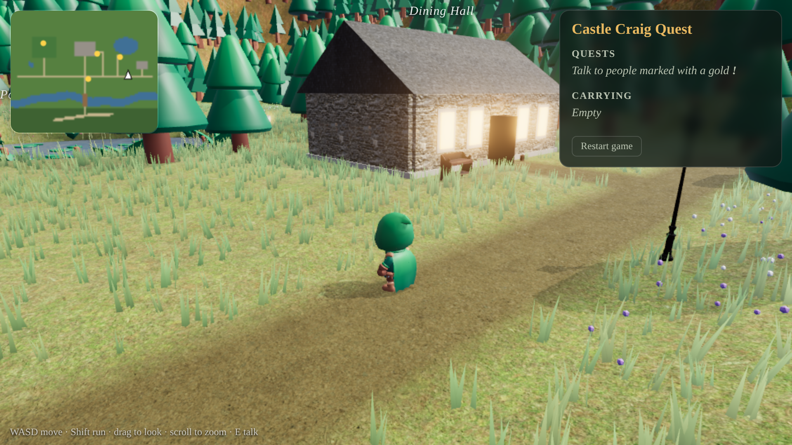
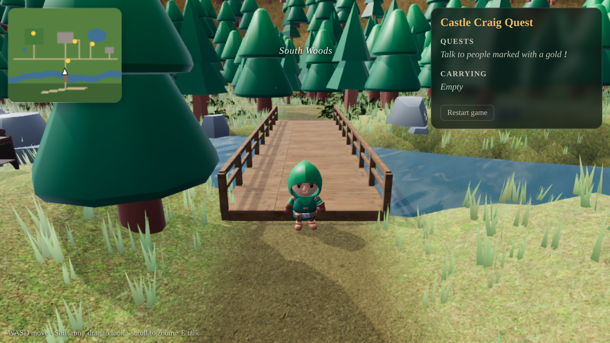
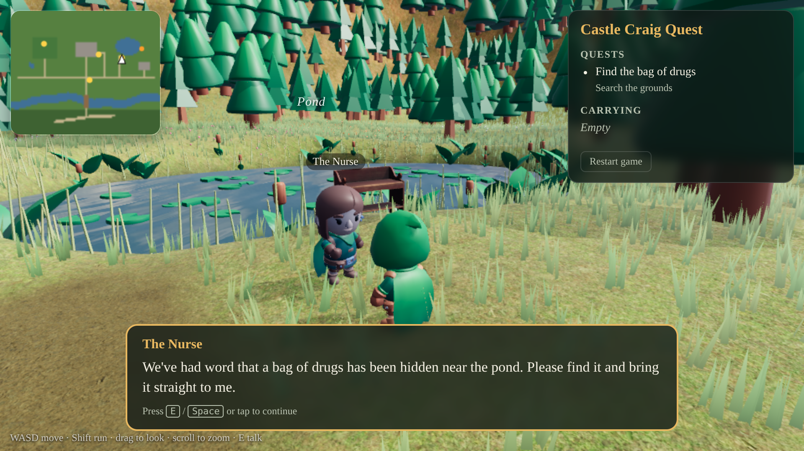
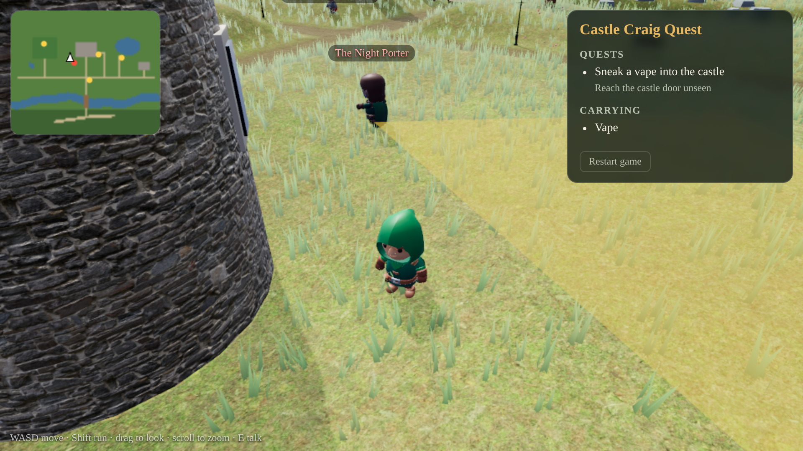

# Castle Craig Quest

A 3D browser game set in the grounds of Castle Craig ([castlecraig.co.uk](https://www.castlecraig.co.uk)).
Roam the estate, talk to the people you meet and complete their quests.

Built with [Three.js](https://threejs.org) and [Vite](https://vite.dev), using free CC0 assets from
[Poly Haven](https://polyhaven.com) and [KayKit](https://kaylousberg.com) (see [CREDITS.md](CREDITS.md)).


## Play locally

```bash
npm install
```

```bash
npm run dev
```

Then open the address Vite prints (usually http://localhost:5173).

### Controls

| | Desktop | Phone / tablet |
| --- | --- | --- |
| Move | WASD or arrow keys | Drag on the left half of the screen |
| Run | Hold Shift | Push the stick all the way out |
| Look around | Drag with the mouse, scroll to zoom | Drag on the right half of the screen |
| Talk / continue | E, Space or Enter | **Talk** button |

Progress saves automatically in the browser. Use **Restart game** in the quest panel to start again.

## Quests

| Quest | Given by | What to do |
| --- | --- | --- |
| Find the empty vodka bottle | The Groundskeeper (main drive) | Search the woods south of the river and bring the bottle back. |
| Find the bag of drugs | The Nurse (south of the pond) | Search the edge of the pond and hand the bag in. |
| Dining hall dash | The Cook (by the kitchen door) | Run to the dining hall and back to the castle door in 28 seconds. |
| Sneak a vape into the castle | The Resident (walled garden) | Collect the vape behind the walled garden and reach the castle door without the Night Porter seeing you. If you're spotted, the vape goes back to its hiding place. |

Items for active quests have a golden beam of light above them and appear as orange dots on the minimap.

## Building and deploying

```bash
npm run build
```

This writes a static site to `dist/` that can be hosted anywhere (GitHub Pages, Netlify, Cloudflare Pages
or a folder on the existing website). The included GitHub Actions workflow publishes it to GitHub Pages on
every push to `main` once Pages is enabled for the repository (Settings → Pages → Source: GitHub Actions).

Add `?q=low` or `?q=high` to the URL to force the graphics quality. Phones and small screens use low quality
by default (fewer grass blades, smaller shadow maps, no ferns).

## Project layout

| Path | What it is |
| --- | --- |
| `src/main.js` | Renderer, lighting, camera, controls, quest logic, the Night Porter's patrol and the HUD |
| `src/world.js` | Builds the estate: terrain, water, castle, walled garden, dining hall, bridge, trees, grass |
| `src/layout.js` | Positions of everything, ground height, paths and collision |
| `src/quests.js` | Characters, quest text, item positions and the patrol route |
| `src/characters.js` | Animated characters (idle, walk, run, cheer, pick up) |
| `src/assets.js` | Loads the vendor assets and analyses the sky to place the sun |
| `src/textures.js` | Small procedural textures (hedge leaves, water ripples, item glow) |
| `public/assets/` | Vendor models, textures and the HDRI sky |

### Editing quests

Quest text, item positions and characters are all in `src/quests.js`. There are three quest types:

- `fetch`: find the listed `items` and bring them back to the quest giver
- `timed`: reach each of the `checkpoints` in order within `timeLimit` seconds
- `sneak`: carry the `item` to the `target` without the patrol seeing you

Positions are in metres. The map runs roughly from x −90 to 90 (west to east) and z −70 to 80 (north to south).
The layout is a stylised version of the grounds, not an accurate plan.

## Screenshots

| | |
| --- | --- |
|  |  |
|  |  |
|  |  |
